  

  
  
  

---

## 🧑‍💻 About Me

- 🏦 Currently building robust data systems & platforms as a **Senior Analytics Engineer at GPBank** (Engineering Team).
- 🏘️ Co-owner of **Xóm Data**, a data community in Vietnam. Search "Xóm Data" on Facebook to find us!
- 🛒 Background in **e-commerce, fintech and banking**: Shopee, VNPAY, TNEX, UpBase, HV Holdings.
- 🎓 Former **Data Instructor & Curriculum Designer** at MindX Technology School, teaching Data for Everyone (D4E) and BI.
- 🌏 Expert **Advisor** for AlphaSights and Arches, sharing practical insights on the Southeast Asia market.
- 📍 Based in Hanoi, Vietnam.

  

  

  

<b>More experience</b>

- **Cloud Ace Vietnam** (Dec 2025 – Feb 2026): BI Developer, built a centralized interactive dashboard system for school leadership reporting.
- **AlphaSights** (Apr 2023 – Feb 2026) and **Arches** (Feb 2025 – Feb 2026): Expert Advisor for investment and corporate strategy clients.
- **FIXMA** (Sep 2024 – Aug 2025): Business Intelligence Developer.
- **VietCleaning** (Jan 2025 – May 2025): Business Intelligence Analyst.
- **BraveBits** (Mar 2024 – Jul 2024): Data Analyst (Outsource), customer and product insights.
- **Ministry of Planning and Investment, Vietnam** (Oct 2020 – Nov 2021): Consultant Network Operator for the National SME Support Portal.

## 🎓 Education & Certifications

- 🎓 **B.Sc. in Economics (Development Economics)**, National Economics University (NEU), 2017 – 2021
- 📜 Data Analytics Essentials
- 📜 Data Analyst Professional Certificate
- 📜 Microsoft PL-300 Exam Preparation and Practice
- 📜 Introduction to Data Analytics on Google Cloud
- 📜 Dagster Essentials

## 🏆 Honors & Awards

- Chemistry Olympiad, Ba Dinh – Tay Ho cluster
- Provincial Merit Competition in Chemistry
- Study Encouragement Scholarship

## 🌐 Languages

🇻🇳 Vietnamese (Native) · 🇬🇧 English (Limited Working)

## 📊 GitHub Stats

  
  

## 📫 Let's Connect

I'm always happy to chat about **data engineering, BI, analytics careers, or teaching data**.

- 💼 LinkedIn: [linkedin.com/in/tunguyenn99](https://www.linkedin.com/in/tunguyenn99)
- ✍️ Blog / Portfolio: [tunguyenn99-portfolio.vercel.app](https://tunguyenn99-portfolio.vercel.app/)
- ✉️ Email: [tunguyen150599@gmail.com](mailto:tunguyen150599@gmail.com)

  

